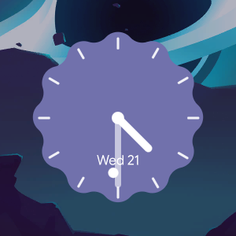

# Nebula Widgets

Shape-based desktop widgets for Caelestia, ported from [Nebula](https://github.com/LilaccFlowerr/Nebula).
The plugin includes the analog clock, calendar, battery, image, and text widgets, plus Nebula's
widget canvas, right-click menu, and add/list corner.



The plugin uses the `desktop-widget` entry point. Widgets sit above the wallpaper and below normal
windows. The menu and corner are overlay windows, and input is masked to the widgets so the rest of
the desktop stays clickable.

## Usage

- Add, enable or remove widgets in **Nexus → Wallpaper & style → Widgets**, next to *Colours*.
- Hover the bottom-left corner for a quick widget list and **Add widget** shortcut. Turn it off with
  the **Corner widget list** switch in **Nexus → System → Plugins → NebulaWidgets**.
- Right-click a widget to change its shape, size, colour, opacity, or source. Drag it to move it.
- GIF and APNG images animate inside their shape.
- Image widgets have a folder button for choosing a picture. Text widgets have an inline editor.
- The calendar expands when clicked; use its arrows or scroll to change months.
- Widget positions and settings are saved to `${XDG_STATE_HOME:-~/.local/state}/caelestia/nebulawidgets.json`.

## Requirements

- A plugin-enabled Caelestia Shell build with the `desktop-widget` entry point and `page-extension`
  sub-pages (2.5.0.r104 or newer), such as `caelestia-shell-plugins-git`.
- `qt6-m3shapes-git` (already required by the shell).

## Install

```sh
mkdir -p ~/.local/share/caelestia/plugins
git clone https://github.com/deeadly137/plugin-nebula-widgets.git \
  ~/.local/share/caelestia/plugins/nebulawidgets
```

Then enable `deeadly137/nebulawidgets` in `~/.config/caelestia/plugins.json`:

```json
{
    "enabled": ["deeadly137/nebulawidgets"]
}
```

Or install it from **Nexus → System → Plugins**.
